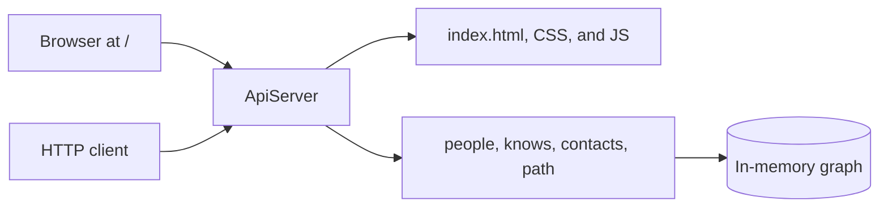

# Nada

In-memory HTTP API for people, mutual connections, and shortest paths of at most three hops.

## Quick start

Install JDK 17 or newer so both `java` and `javac` are on your `PATH`. Maven does not need to be installed separately.

```bash
git clone https://github.com/sharma-Utkarsh-47/nada.git
cd nada
./start.sh
```

Open [http://localhost:8080/](http://localhost:8080/).

`./start.sh` checks the JDK, downloads dependencies with `./mvnw`, runs the tests, builds `target/nada.jar`, and starts the server in the foreground. Ctrl+C stops it. If a step fails, the script exits non-zero and does not start the server.

Another port:

```bash
./start.sh 9090
```

Open [http://localhost:9090/](http://localhost:9090/). If the port is already in use, the script stops and tells you how to pick a different one. It does not kill the other process.

## API

| Method | Path | Success |
| --- | --- | --- |
| `POST` | `/people` | 201 `{"id":1,"name":"Asha"}` |
| `POST` | `/knows` | 204, empty body |
| `GET` | `/people/{id}/contacts` | 200, a JSON array |
| `GET` | `/path?from={id}&to={id}` | 200, a path result |

There is no people-list endpoint and no database. Person ids start at 1 and are chosen by the server. Names are stored exactly as sent, including Hindi and other scripts. A connection is mutual and can be sent again. The path search returns a shortest path of at most three hops, or `{"connected":false}` when none exists.

| Status | When |
| --- | --- |
| 400 | Invalid JSON, a missing field, a blank name, a self-connection, or a bad id or query parameter |
| 404 | Unknown person, for example `{"error":"no person 9"}`, or an unknown route `{"error":"not found"}` |
| 405 | The path exists, but the method is not allowed |

```bash
curl -sS -X POST http://localhost:8080/people -H 'Content-Type: application/json' -d '{"name":"Asha"}'
curl -sS -X POST http://localhost:8080/people -H 'Content-Type: application/json' -d '{"name":"आशा"}'
curl -sS -X POST http://localhost:8080/knows -H 'Content-Type: application/json' -d '{"a":1,"b":2}'
curl -sS http://localhost:8080/people/1/contacts
curl -sS 'http://localhost:8080/path?from=1&to=2'
```

The same person is zero hops: `{"connected":true,"hops":0,"path":[...]}`. In a chain `A-B-C-D-E` with no shortcut, `A` to `D` is connected in 3 hops and `A` to `E` is not.

## Features

- Create a person and let the server assign the id.
- Record a mutual connection. Sending it again is safe.
- List a person's direct contacts, in the order they were first recorded.
- Find a shortest path of at most three hops.
- Open `/` for a small page that calls those endpoints.

## Testing page

`/` serves a plain HTML page. Its CSS and JavaScript are `/assets/app.css` and `/assets/app.js`. The page creates people, loads contacts, records connections, and draws the path returned by `GET /path`. It does not invent results.

The people table lists only people created in that browser session. The server has no list endpoint, so the table is not the full database. Restarting the server drops every person; clearing the local list does not.

## Prerequisites

- JDK 17 or newer. A JRE is not enough, because the build needs `javac`.
- `curl`, for `make smoke`.

Check with `java -version` and `javac -version`. On Ubuntu, `sudo apt install openjdk-21-jdk-headless` installs a suitable JDK. If `java` is present but `javac` is not, the `java` command is probably a JRE.

`./start.sh` uses `./mvnw`, which downloads Maven 3.9.9 on first use. It does not install packages or change system configuration.

## Manual build and test

From the repository root:

```bash
./mvnw -B test
./mvnw -B verify
./mvnw -B -DskipTests package
java -jar target/nada.jar
make smoke
```

`java -jar target/nada.jar 9090` uses that port. With no argument, the `PORT` environment variable is used, then `8080`. `./start.sh` always passes its port on the command line, so that choice wins over `PORT`.

`make smoke` builds the jar, starts it on port 18080 (or `PORT`), checks the homepage, static assets, and the four API calls, then stops only the process it started.

## Architecture

`nada.http.ApiServer` is the JDK HTTP server. `PersonService`, `ConnectionService`, and `PathService` sit on one in-memory repository. The repository lock is the only write path for people and edges. `Limits.MAX_HOPS` is 3. Breadth-first search stops at that depth.

`GET /` and the two asset paths serve files from the jar. Every other unknown route still returns JSON `{"error":"not found"}`.



## Known limitations

- Nothing is persisted. A restart clears people and connections, and ids start at 1 again.
- There is no authentication, pagination, or `GET /people`.
- The hop limit is fixed at three.
- The testing page can send ids only up to JavaScript's safe integer range. `curl` can still send any `long`.
- The page's people table is session-local. Server state is authoritative.
- A request target with illegal percent-encoding, such as `%ZZ`, is rejected by the JDK HTTP server with an HTML 400 before this application can write JSON.
- One shared lock keeps the graph consistent. That is not a production throughput claim.

## With more time

- Persist people and connections so a restart does not wipe the graph.
- Add an explicit people-list endpoint and paginate large contact lists.
- Make the hop limit configurable, and publish an OpenAPI description.

## AI tools

Cursor's coding assistant (Auto) wrote this service, its tests, the Maven wrapper, the Makefile, the smoke script, the testing page, `start.sh`, and this README from the assignment brief. Behavior was checked with `./mvnw -B test`, `./mvnw -B verify`, `make smoke`, `./start.sh`, and the testing page in a browser.
