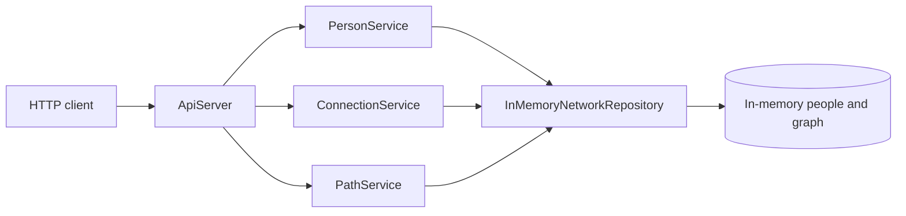
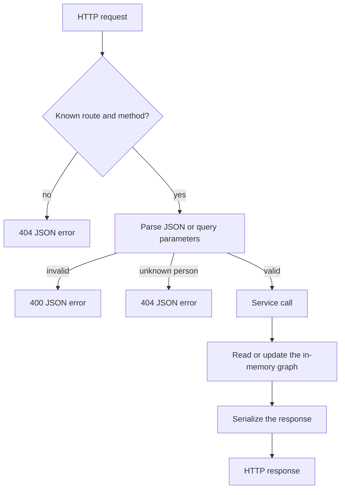
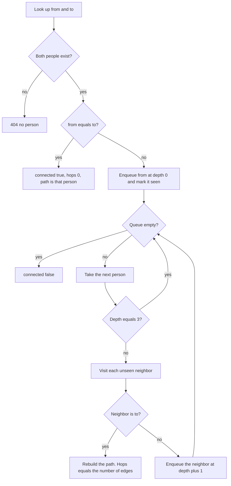

# Nada people and connections API

Small HTTP API for the Nada backend intern assignment. It stores people and the people they know, then answers whether two people are connected by a shortest path of at most three hops.

Nada uses that kind of path to describe how two families already know each other.

## Features

- Create a person and let the server assign the id.
- Record a mutual, undirected connection. Sending it again is safe.
- List a person's direct contacts.
- Find a shortest path of at most three hops, or report that none exists.

## Stack

- Java 17 or newer (compiled with `--release 17`; verified with JDK 21)
- Maven 3.9 or newer
- Jackson for JSON
- The JDK `com.sun.net.httpserver.HttpServer`
- JUnit 5

Data stays in memory. There is no database, Neo4j, or extra framework.

## Architecture

| Package | Responsibility |
| --- | --- |
| `nada.model` | `Person`, path results, and error bodies |
| `nada.repository` | In-memory people and the undirected contact graph |
| `nada.service` | Creating people, recording connections, and bounded shortest-path search |
| `nada.http` | Routing, JSON parsing, validation, and responses |
| `nada.error` | `400` and `404` exceptions mapped to one JSON error shape |

`Limits.MAX_HOPS` is the only hop limit. The repository lock is the only write path for people and edges, so the two cannot diverge.







Breadth-first search finds a shortest path in an unweighted graph. Nodes at depth 3 are not expanded, so a fourth hop is never explored. A seen-set stops cycles.

## Prerequisites

- JDK 17 or newer (`java` and `javac` on your `PATH`)
- Maven 3.9 or newer

Check both:

```bash
java -version
mvn -version
```

## Build and run

From the repository root:

```bash
mvn -q package
java -jar target/nada.jar
```

The server listens on port **8080** and prints:

```text
Nada server listening on http://localhost:8080
```

Stop it with Ctrl+C. The shutdown hook closes the server.

### Port

The first command-line argument wins, then the `PORT` environment variable, then `8080`.

```bash
java -jar target/nada.jar 9090
PORT=9090 java -jar target/nada.jar
```

`java -jar target/nada.jar 9090` uses 9090 even if `PORT` is set. An invalid port prints `Port must be an integer between 0 and 65535` and exits with status 1.

`mvn -q package` runs the tests before building the jar. Use `mvn -q -DskipTests package` when you only want the jar.

## Tests

Unit tests and HTTP tests are one JUnit 5 suite.

```bash
mvn test
```

Repository and service tests:

```bash
mvn -Dtest=InMemoryNetworkRepositoryTest,NetworkServiceTest,NadaApplicationTest test
```

HTTP integration tests, which start a real server on an ephemeral port:

```bash
mvn -Dtest=ApiServerTest test
```

Clean build plus the full suite:

```bash
mvn clean verify
```

## API

Request and response bodies are JSON, encoded as UTF-8. Successful and error responses from the application use `Content-Type: application/json; charset=UTF-8`. `POST /knows` returns an empty body. The examples are separate illustrations of each response, not one continuous session.

| Status | When |
| --- | --- |
| 201 | A person was created |
| 204 | A connection was recorded, including a duplicate |
| 200 | Contacts or a path result |
| 400 | Invalid JSON, a missing or invalid field, a blank name, a self-connection, or a bad query parameter |
| 404 | The person id is unknown |
| 405 | The path exists but the method is not supported |

Application errors use `{"error":"..."}`. An unknown id `9` is exactly `{"error":"no person 9"}`.

### `POST /people`

Creates a person. The server assigns the id, starting at 1. A client-supplied `id` is ignored. The name is stored exactly as sent, including Hindi and other scripts. A name that is missing, not a string, empty, or whitespace-only is rejected.

```bash
curl -sS -D - -X POST http://localhost:8080/people \
  -H 'Content-Type: application/json' \
  -d '{"name":"Asha"}'
```

```http
HTTP/1.1 201 Created
Content-Type: application/json; charset=UTF-8

{"id":1,"name":"Asha"}
```

```bash
curl -sS -X POST http://localhost:8080/people \
  -H 'Content-Type: application/json' \
  -d '{"name":"आशा"}'
```

```json
{"id":2,"name":"आशा"}
```

```bash
curl -sS -D - -X POST http://localhost:8080/people \
  -H 'Content-Type: application/json' \
  -d '{"name":"  "}'
```

```http
HTTP/1.1 400 Bad Request

{"error":"name must not be blank"}
```

Other person errors: `invalid JSON`, `name is required`, `name must be a string`.

### `POST /knows`

Creates one undirected connection. Both people must exist, and `a` must not equal `b`. Repeating the pair, in either order, returns 204 and does not add another contact.

```bash
curl -sS -D - -X POST http://localhost:8080/knows \
  -H 'Content-Type: application/json' \
  -d '{"a":1,"b":2}'
```

```http
HTTP/1.1 204 No Content
```

```bash
curl -sS -X POST http://localhost:8080/knows \
  -H 'Content-Type: application/json' \
  -d '{"a":1,"b":1}'
```

```json
{"error":"a person cannot be connected to themselves"}
```

```bash
curl -sS -X POST http://localhost:8080/knows \
  -H 'Content-Type: application/json' \
  -d '{"a":1,"b":9}'
```

```json
{"error":"no person 9"}
```

Missing fields produce `a is required` or `b is required`. A non-integer value produces `a must be an integer` or `b must be an integer`.

### `GET /people/{id}/contacts`

Returns the direct contacts in the order each connection was first recorded for that person. A person with no contacts gets an empty array. Indirect contacts are not included.

After Asha (1) knows Rohan (2):

```bash
curl -sS http://localhost:8080/people/1/contacts
```

```json
[{"id":2,"name":"Rohan"}]
```

A person who exists and has no contacts gets:

```json
[]
```

```bash
curl -sS http://localhost:8080/people/9/contacts
```

```json
{"error":"no person 9"}
```

A non-integer id, such as `/people/abc/contacts`, returns 400 `{"error":"person id must be an integer"}`.

### `GET /path?from={id}&to={id}`

Returns the shortest path of **at most three hops**. Hops are edges, not people. If several paths have the same length, any one of them may be returned. If the people exist but every path is longer than three hops, or there is no path, the body is `{"connected":false}`.

The same existing person is a zero-hop path:

```bash
curl -sS 'http://localhost:8080/path?from=1&to=1'
```

```json
{"connected":true,"hops":0,"path":[{"id":1,"name":"Asha"}]}
```

A two-hop path:

```bash
curl -sS 'http://localhost:8080/path?from=1&to=5'
```

```json
{"connected":true,"hops":2,"path":[{"id":1,"name":"Asha"},{"id":3,"name":"Meera"},{"id":5,"name":"Kabir"}]}
```

In a chain `A - B - C - D - E` with no shortcut, `A` to `D` is connected in 3 hops. `A` to `E` is not:

```json
{"connected":false}
```

Missing, empty, or non-numeric `from` or `to` returns 400, for example `{"error":"from is required"}` or `{"error":"to must be an integer"}`. An unknown person returns 404 `{"error":"no person 5"}`. A route this server does not implement returns 404 `{"error":"not found"}`. Both parameters are checked as integers before either id is looked up. If both ids are unknown, the error names `from`.

## Storage

People and connections live in the process heap. Restarting the server drops all of them, and the next person starts at id 1 again. Nothing is written to disk.

## Design decisions

- Person ids are positive `long` values, start at 1, and are never reused. Only a successful create consumes an id.
- A connection is two adjacency entries updated together under one lock. Concurrent requests cannot see a one-sided edge.
- The first time a pair is recorded decides its position in each contact list. A later duplicate, including the reversed pair, does not move or duplicate it.
- A self-connection (`a == b`) is 400 even when that id does not exist.
- Blank means Java `String.isBlank()`. A non-blank name is not trimmed.
- Extra JSON fields are ignored. Request bodies are UTF-8 and are refused above 64 KiB.
- Path search is breadth-first and stops at three hops. Neighbor order follows contact insertion order, so the chosen shortest path is stable for a given sequence of connections.
- The server binds all interfaces. The printed URL uses `localhost`.
- A single trailing slash on a route is accepted.

## Known limitations

- There is no authentication, pagination, or persistence.
- Graph updates share one lock. That keeps the graph consistent; it is not a claim about production throughput.
- The hop limit is fixed at three.
- A request target with illegal percent-encoding, such as `%ZZ`, is rejected by the JDK HTTP server with an HTML `400` before this application can write JSON. Query values that are merely missing or not integers still get a JSON `400`.
- The jar is a small take-home service, not a production deployment.

## With more time

- Persist people and connections so a restart does not wipe the graph.
- Publish an OpenAPI description and structured request logs.
- Make the hop limit configurable and paginate large contact lists.
- Add a focused load test around id allocation and connection updates.

## AI tools

Cursor's coding assistant (Auto) wrote this service, its tests, and this README from the assignment brief. The behavior was checked with `mvn test`, `mvn clean verify`, and manual `curl` requests against a running server. Failures from those runs were fixed before the code was committed.
