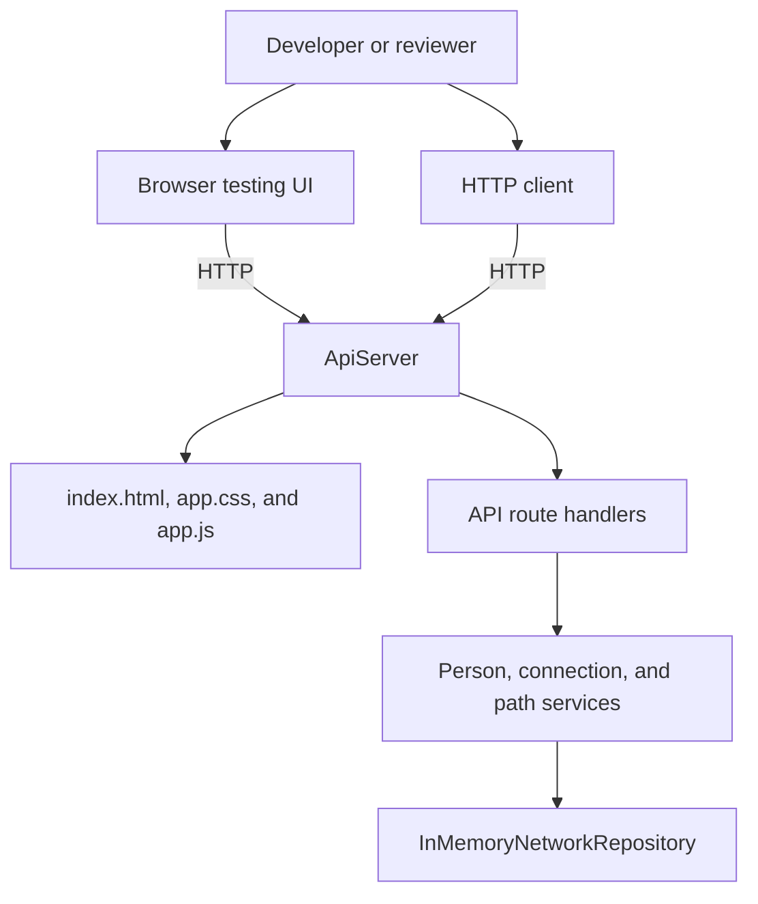
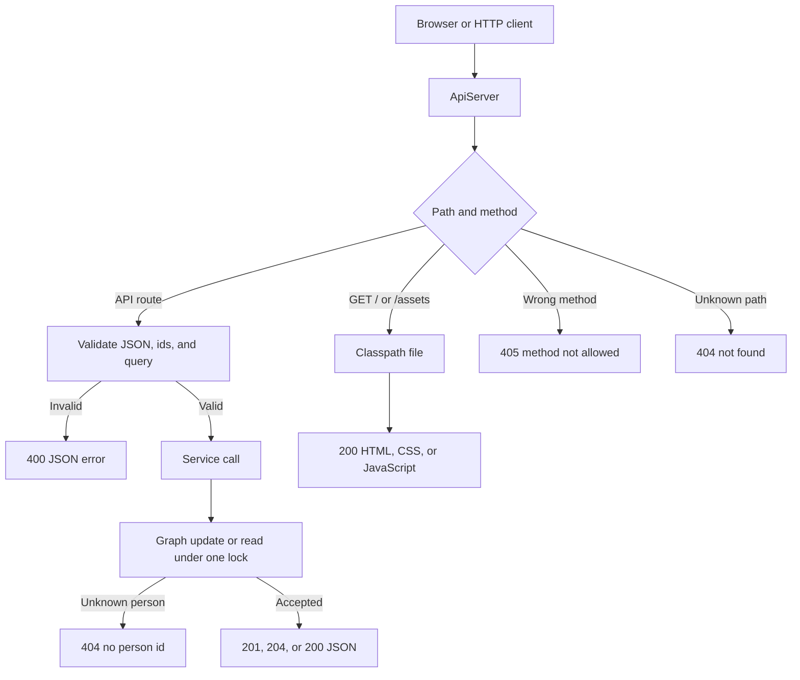
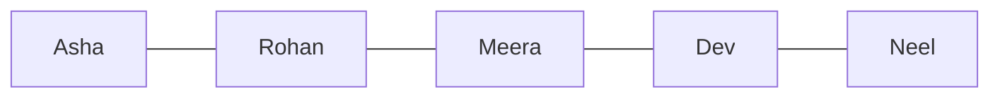
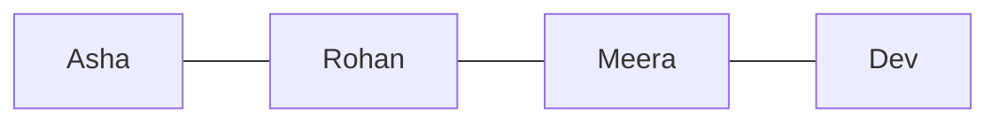
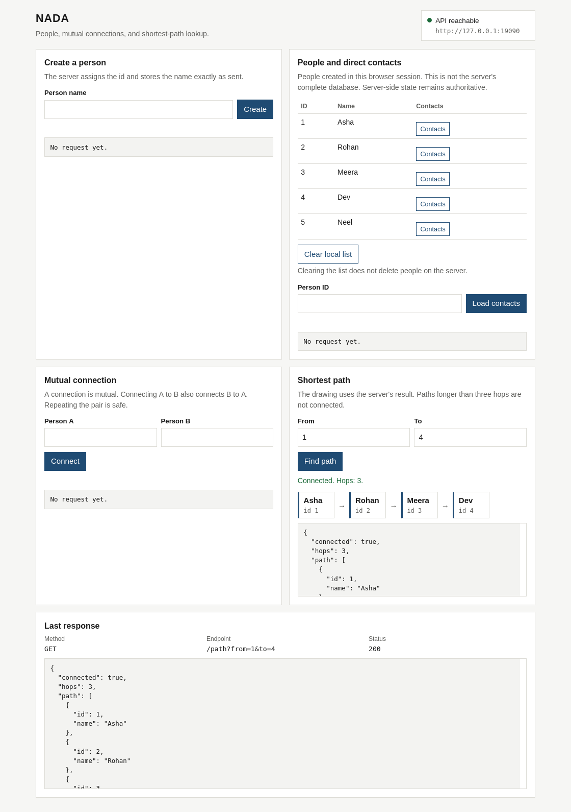

# NADA

In-memory HTTP API for people, mutual connections, and shortest paths of at most three hops.

## Quick start

```bash
git clone https://github.com/Utkarsh-sharma47/nada.git
cd nada
./start.sh
```

Open [http://localhost:8080/](http://localhost:8080/).

`./start.sh` checks that `java` and `javac` come from JDK 17 or newer, resolves dependencies with the committed Maven Wrapper, runs the tests, builds `target/nada.jar`, and starts the server in the foreground. The terminal prints the UI and API URLs. Ctrl+C stops the server. If a check, a test, or the build fails, the script exits and does not leave the server running.

Another port:

```bash
./start.sh 9090
```

Open [http://localhost:9090/](http://localhost:9090/).

## Prerequisites and troubleshooting

- JDK 17 or newer, with both `java` and `javac` on `PATH`. The build compiles the project, so a JRE is insufficient. Check with `java -version` and `javac -version`.
- Bash, which is what `./start.sh` runs under. Use it from the repository root on Linux or macOS.
- A network connection the first time `./mvnw` runs. The wrapper downloads Maven 3.9.9 and the project dependencies. Later runs reuse the local Maven cache.
- `curl`, only for `make smoke`.

A global Maven install is unnecessary. `./start.sh` calls `./mvnw`.

If `java` is missing, or `java` is present and `javac` is not, `./start.sh` prints the problem and exits. On Ubuntu or Debian, `sudo apt install openjdk-21-jdk-headless` installs a suitable JDK. If a JDK is already installed, put it on `PATH` or set `JAVA_HOME` to that JDK directory. `JAVA_HOME` must contain both `bin/java` and `bin/javac`. The script does not install Java or change system packages.

If the shell reports `Permission denied`, the checkout dropped the executable bit:

```bash
chmod +x start.sh mvnw
./start.sh
```

A normal clone already has those bits set. If `./mvnw` is not executable, `./start.sh` stops and tells you to run `chmod +x mvnw`. It does not change file modes itself.

The port must be an integer from 1 to 65535. `./start.sh` passes that port on the command line, so a `PORT` variable in the environment does not override it. If something is already listening, the script stops and names another command, such as `./start.sh 9090`. It does not stop the other process.

Startup output is printed in the same terminal. The last `==>` line shows how far the script got: Java, dependencies, tests, packaging, or the server. A failing test is Maven Surefire output above the exit. The server starts only after those steps succeed. If the process then stops, its message is in that output. `Address already in use` means the port was taken after the earlier check; choose a different port and run `./start.sh` again.

Manual build and test commands are in [Testing and development](#testing-and-development).

## What NADA does

NADA stores people and mutual “knows” relationships in memory and answers two questions: who is directly connected to a person, and whether two people are connected by a shortest path of at most three hops.

The assignment surface is four HTTP calls: create a person, record a connection, list direct contacts, and look up a path. The page at `/` is optional developer tooling for calling those same endpoints in a browser. Restarting the process drops every person and connection. Ids then start at 1 again.

- Create a person. The server assigns the id and stores the name exactly as sent, including Hindi and other scripts.
- Record a mutual connection. Sending the same pair again, in either direction, is safe.
- List a person’s direct contacts, in the order each connection was first recorded.
- Find one shortest path of at most three hops, or report that no such path exists.
- Open `/` when you want a page that shows the HTTP status and JSON for those calls.

| Piece | What the repository uses |
| --- | --- |
| Language | Java 17 or newer |
| HTTP | JDK `HttpServer` (`com.sun.net.httpserver`) |
| JSON | Jackson Databind 2.18.2 |
| Build | Maven Wrapper, Maven 3.9.9, shaded `target/nada.jar` |
| Tests | JUnit Jupiter 5.11.4 |
| Browser page | HTML, CSS, and JavaScript served from the jar |

## Architecture

`NadaApplication` selects a port and starts `ApiServer`. The server owns one `InMemoryNetworkRepository` and three services that share it: `PersonService`, `ConnectionService`, and `PathService`. Jackson, through `JsonCodec`, reads request bodies and writes responses. Static files for the testing page are classpath resources in the same jar.

### Components



The browser and an HTTP client such as `curl` both talk only to `ApiServer`. Route handlers call the services. The services are the only code that reads or writes the graph.

### Request lifecycle



`ApiServer.handle` turns an `ApiException` into `{"error":"..."}` and keeps the process running. An unexpected failure becomes HTTP 500 `{"error":"internal error"}`. A request target with illegal percent-encoding, such as `%ZZ`, is rejected by the JDK HTTP server with an HTML 400 before this application can write JSON. Later requests still succeed.

Request bodies larger than 64 KiB (`Limits.MAX_BODY_BYTES`) are refused with `{"error":"request body is too large"}`.

### Connections and the three-hop limit

Connections are undirected. Recording that Asha knows Rohan also records that Rohan knows Asha. The pictures below are explanatory. A new process starts with an empty graph, and these names are not built in.

A chain of four hops:



`GET /path?from=1&to=4` follows Asha, Rohan, Meera, and Dev. That is three hops, so the response is connected:



`GET /path?from=1&to=5` would need a fourth hop to reach Neel. The search stops at three hops and returns `{"connected":false}`. The same answer is used when the two people are in different components. The same person is a path of zero hops.

Breadth-first search in `PathService` returns one shortest path. A direct edge is chosen over a longer chain. When several shortest paths exist, the one discovered first is returned. Discovery follows the order in which each person’s contacts were first recorded. The hop limit is `Limits.MAX_HOPS`, which is 3. Nodes already three hops from the start are not expanded, so a cycle cannot be walked forever.

### Repository layout

```text
.
├── start.sh                     # check the JDK, test, build, and run in the foreground
├── mvnw                         # Maven Wrapper used by start.sh and the commands below
├── pom.xml                      # Java 17 build, JUnit, Jackson, and the shaded jar
├── Makefile                     # test, verify, package, run, and smoke targets
├── scripts/smoke.sh             # HTTP checks against a server that this script stops
├── .github/workflows/ci.yml     # runs ./mvnw -B verify on Java 17
└── src
    ├── main/java/nada
    │   ├── NadaApplication.java # port selection and startup
    │   ├── Limits.java          # hop limit, body limit, and default port 8080
    │   ├── http/                # ApiServer routing and Jackson JsonCodec
    │   ├── service/             # create people, connect them, and search paths
    │   ├── repository/          # in-memory people and undirected edges
    │   ├── model/               # Person, PathResult, and ErrorBody
    │   └── error/               # 400 and 404 exceptions
    ├── main/resources/static/   # index.html, app.css, and app.js
    └── test/java/nada/          # repository, service, HTTP, and port tests
```

## API

All JSON uses UTF-8. Error bodies are `{"error":"message"}`. Person ids are `long` values assigned by the server, starting at 1 for a fresh process. There is no people-list endpoint. A trailing slash on a known path is ignored, so `/people/1/contacts/` matches `/people/1/contacts`.

The block below assumes a new server on port 8080. Ids match the responses only when these are the first people created in that process.

```bash
curl -sS -X POST http://localhost:8080/people -H 'Content-Type: application/json' -d '{"name":"Asha"}'
curl -sS -X POST http://localhost:8080/people -H 'Content-Type: application/json' -d '{"name":"Rohan"}'
curl -sS -X POST http://localhost:8080/people -H 'Content-Type: application/json' -d '{"name":"Meera"}'
curl -sS -X POST http://localhost:8080/people -H 'Content-Type: application/json' -d '{"name":"Dev"}'
curl -sS -X POST http://localhost:8080/people -H 'Content-Type: application/json' -d '{"name":"Neel"}'
curl -sS -o /dev/null -w "knows %{http_code}\n" -X POST http://localhost:8080/knows -H 'Content-Type: application/json' -d '{"a":1,"b":2}'
curl -sS -o /dev/null -w "knows %{http_code}\n" -X POST http://localhost:8080/knows -H 'Content-Type: application/json' -d '{"a":2,"b":3}'
curl -sS -o /dev/null -w "knows %{http_code}\n" -X POST http://localhost:8080/knows -H 'Content-Type: application/json' -d '{"a":3,"b":4}'
curl -sS -o /dev/null -w "knows %{http_code}\n" -X POST http://localhost:8080/knows -H 'Content-Type: application/json' -d '{"a":4,"b":5}'
curl -sS http://localhost:8080/people/2/contacts
curl -sS 'http://localhost:8080/path?from=1&to=4'
curl -sS 'http://localhost:8080/path?from=1&to=5'
```

Rohan’s contacts, the three-hop path, and the path past the limit:

```json
[{"id":1,"name":"Asha"},{"id":3,"name":"Meera"}]
```

```json
{"connected":true,"hops":3,"path":[{"id":1,"name":"Asha"},{"id":2,"name":"Rohan"},{"id":3,"name":"Meera"},{"id":4,"name":"Dev"}]}
```

```json
{"connected":false}
```

The server sends compact JSON. The examples above are the response bodies. `POST /knows` returns 204 and an empty body, which is why those `curl` lines print only the status code.

### `POST /people`

Creates a person. The server assigns `id`. A client field named `id` is ignored. The `name` string is stored exactly, including surrounding spaces and non-Latin scripts.

```bash
curl -sS -X POST http://localhost:8080/people -H 'Content-Type: application/json' -d '{"name":"आशा"}'
```

On a fresh process the first person is id 1:

```json
{"id":1,"name":"आशा"}
```

| Status | When |
| --- | --- |
| 201 | Person created. Body is `{"id":1,"name":"आशा"}`. |
| 400 | `invalid JSON`, including an empty body, a non-object, or a second JSON value after the object. `name is required` when `name` is missing or null. `name must be a string` when it is not a string. `name must not be blank` when the string is empty or whitespace. `request body is too large` above 64 KiB. |
| 405 | Any method other than `POST`. `GET /people` is 405 because the path exists and listing is not implemented. |

Trailing whitespace after one JSON object is accepted.

### `POST /knows`

Records one undirected connection between `a` and `b`. Repeating the pair, or sending it reversed, returns 204 again and does not add a second contact. Both ids are JSON numbers. Numeric strings and fractional numbers are rejected, including `1.0`.

```bash
curl -sS -D - -o /dev/null -X POST http://localhost:8080/knows -H 'Content-Type: application/json' -d '{"a":1,"b":2}'
```

A successful response has status 204 and an empty body. Each side’s contact list then contains the other person.

| Status | When |
| --- | --- |
| 204 | The connection is stored, or the same pair was already stored. |
| 400 | Invalid JSON, a missing `a` or `b`, a non-integer id, or a self-connection (`a person cannot be connected to themselves`). A self-connection is rejected even when that id does not exist, and no edge is stored. |
| 404 | One or both people are missing: `{"error":"no person 2"}`. If both are missing, the message names `a`. No edge is stored. |
| 405 | Any method other than `POST`. |

Contact order follows the first successful recording of each pair. A repeated call does not move an existing contact.

### `GET /people/{id}/contacts`

Returns the person’s direct contacts. People farther away are omitted. The array is empty when the person exists and has no contacts.

```bash
curl -sS http://localhost:8080/people/1/contacts
```

After the chain above, Asha’s only direct contact is Rohan:

```json
[{"id":2,"name":"Rohan"}]
```

| Status | When |
| --- | --- |
| 200 | A JSON array of `{"id":...,"name":"..."}` objects, in first-recorded order. |
| 400 | `person id must be an integer`, for example `/people/abc/contacts` or `/people/1.5/contacts`. |
| 404 | `{"error":"no person 9"}` when that id was never created. |
| 405 | Any method other than `GET`. |

### `GET /path?from={id}&to={id}`

Returns one shortest path of at most three hops. `hops` counts edges, so the path array has `hops + 1` people. When `connected` is false, `hops` and `path` are omitted.

```bash
curl -sS 'http://localhost:8080/path?from=1&to=1'
```

```json
{"connected":true,"hops":0,"path":[{"id":1,"name":"Asha"}]}
```

| Status | When |
| --- | --- |
| 200 | `connected` is true and `path` is present, or the body is exactly `{"connected":false}` because no path of three hops or fewer exists. |
| 400 | `from` or `to` is missing, blank, not an integer, or outside the `long` range. The message names the parameter, for example `from must be an integer`. |
| 404 | Either id is not a person: `{"error":"no person 5"}`. If both are missing, the message names `from`. |
| 405 | Any method other than `GET`. |

Failed requests leave earlier people and connections in place.

## Browser UI

With the server running, open [http://localhost:8080/](http://localhost:8080/). The page is `GET /`. Its stylesheet and script are `GET /assets/app.css` and `GET /assets/app.js`. Other asset paths, including `/static/index.html`, return JSON `{"error":"not found"}`.



The capture is a real page after the five-person chain in the API example. The drawing and the Last response panel show `GET /path?from=1&to=4`. The address in the header is the origin of that run, so a server on another port shows that port instead. Each response box scrolls, which is why the JSON panels show the start of the body.

- **Create a person.** Type a name and choose Create. The id in the response is the server’s id. The name is sent as typed.
- **Connect two people.** Enter the two ids and choose Connect. A 204 response has an empty body; the page reports the status.
- **Inspect direct contacts.** Enter an id and choose Load contacts, or choose Contacts on a row. The list is the JSON array from `GET /people/{id}/contacts`.
- **Explore a path.** Enter From and To and choose Find path. The drawing is the `path` array from the server. A false `connected` value is shown as not connected within three hops.
- **Read the status.** Each form prints the HTTP status and the response body. The Last response panel repeats the method, path, status, and body for the latest call.

The people table is stored in this tab’s `sessionStorage` under `nada.sessionPeople`. It contains people created in that tab. The server has no list API, so the table can omit people created by `curl` and can still show people after a restart has cleared the server. Clear local list removes only that browser list. Restarting the server clears people, connections, and ids. The page can send ids only inside JavaScript’s safe integer range. `curl` can send any `long`.

The header status means this origin answered an HTTP request. It does not mean the graph contains any people.

## Testing and development

Run these from the repository root. They use `./mvnw`.

### Tests and build

```bash
./mvnw -B clean test
./mvnw -B verify
```

`./mvnw -B clean test` deletes `target/` and runs the unit and HTTP tests. `./mvnw -B verify` runs the same tests and packages `target/nada.jar`. `make test` and `make verify` call those Maven goals.

| Layer | What it covers |
| --- | --- |
| `InMemoryNetworkRepositoryTest` | Ids from 1, one undirected edge in either direction, contact order, and concurrent inserts |
| `NetworkServiceTest` | Blank names, rejected self-connections, the hop limit, shorter paths, cycles, and a missing id chosen under the repository lock |
| `ApiServerTest` | The four endpoints, status codes, Unicode names, static files, unknown routes, oversized bodies, and concurrent requests |
| `NadaApplicationTest` | Default port 8080, a command-line port overriding `PORT`, and rejected ports |

GitHub Actions runs `./mvnw -B verify` on Temurin 17 (`.github/workflows/ci.yml`).

### HTTP smoke test

```bash
make smoke
```

`make smoke` packages the jar with tests skipped, then `scripts/smoke.sh` starts a separate server on port 18080, or on `PORT` if that variable is set. It checks the homepage, both assets, a JSON 404, a 405 on `GET /people`, and the four API calls, including a three-hop path and a longer chain that is disconnected. It then stops only the process it started. `curl` must be on `PATH`. If 18080 is taken, run `PORT=19080 make smoke`.

### Server without running the tests again

```bash
./mvnw -B -DskipTests package
java -jar target/nada.jar
```

`make run` is the same two steps. Another port, with the argument taking priority over `PORT`:

```bash
java -jar target/nada.jar 9090
PORT=9090 java -jar target/nada.jar
```

`java -jar` accepts a port from 0 to 65535. Port 0 asks the JDK to choose a free port, and the printed URL shows which one. `./start.sh` only accepts 1 to 65535 and always passes the port itself.

## Design decisions

The graph lives in the server process. The assignment asks for people, mutual connections, direct contacts, and a three-hop shortest path. A database, a migration tool, and a persistence API would not change those answers, so they are absent. The cost is that a restart clears the data. That is a limitation, described below.

A connection is one undirected edge stored on both adjacency sets. `LinkedHashSet` keeps the first-seen contact order and makes a repeated pair a no-op. Person ids come from one counter under the same lock, start at 1, and are not reused while the process runs.

`PathService` holds the repository lock for the whole breadth-first search, so the path is computed against one consistent snapshot. Search stops expanding at three hops. The response shape matches that rule: a short enough path includes `hops` and `path`, and every longer or missing route is `{"connected":false}` with those fields omitted.

Handlers validate before they write. A bad name, a self-connection, a non-integer, or an unknown person produces a JSON 400 or 404 and leaves the graph unchanged. `JsonCodec` rejects a second JSON value in the same body, so `{"name":"Asha"}{"name":"Other"}` does not create a person. Names are not trimmed, because the assignment stores the submitted name.

HTTP work runs on a daemon pool named `nada-http`. One lock serializes graph reads and writes, including a connection’s two adjacency updates, so a request cannot observe a one-sided edge. That lock is there for consistency under concurrent requests. It is not a throughput design.

The testing page is a static file in the jar. It calls the public API and renders the JSON it receives. It is not a second implementation of the path search.

## Limitations

- People and connections exist only in memory. Stopping the process deletes them, and the next start assigns id 1 again.
- There is no authentication, no pagination, and no `GET /people`.
- The hop limit is fixed at three.
- The testing page’s people table is `sessionStorage` for one tab. It can disagree with the server after a restart or after people are created outside that tab.
- The page refuses ids outside JavaScript’s safe integer range. The HTTP API still accepts any `long`.
- An illegal percent-encoded request target is an HTML 400 from the JDK HTTP server, not this application’s JSON error.
- The shared lock keeps the graph consistent. It does not bound the cached HTTP thread pool.

## Future improvements

**Correctness and reliability**

- Persist people, edges, and the id counter so a restart keeps the graph.
- Bound the HTTP thread pool so a burst of connections cannot create an unbounded number of threads.
- Give the testing page a way to detect a restarted server and drop the stale tab list.

**Developer experience**

- Add a people-list endpoint and point the testing page at it, so the table shows server state.
- Publish an OpenAPI description generated from the routes above.
- Add a startup switch that skips tests when `target/nada.jar` is already current. Until then, use `java -jar` as documented.

**Possible extensions**

- Make the hop limit configurable, with 3 remaining the default.
- Paginate large contact lists.
- Add authentication if the service were ever bound beyond a local reviewer machine.

## AI tools

Cursor’s coding assistant (Auto) implemented this service, its tests, the Maven Wrapper setup, the Makefile, `scripts/smoke.sh`, the testing page, `start.sh`, and this README from the assignment brief. The behavior described here was checked with `./mvnw -B clean test`, `./mvnw -B verify`, `make smoke`, `./start.sh`, and the testing page in a browser.
